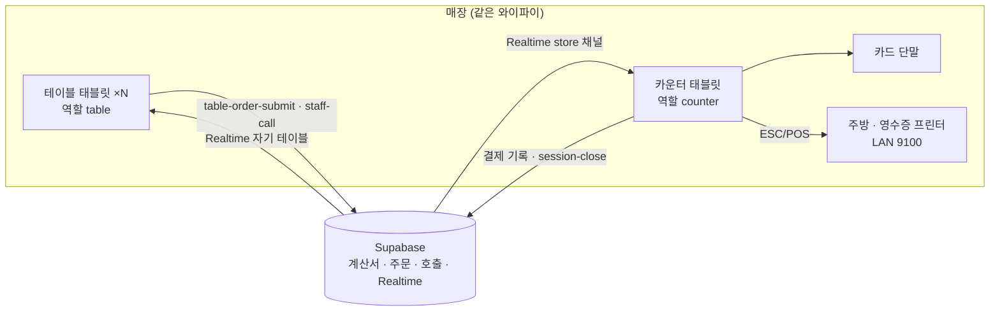
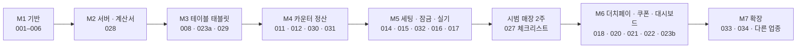

# 04 개발 기획 — 고깃집 테이블오더

> 디자인(48장)과 명세(`specs/`)를 기준으로, **무엇을 · 어떤 순서로 · 어떻게 확인하며** 만드는지 정한 문서입니다.
> 실제 작업 단위는 core `tasks/`(task-001 ~ 034)이고, 이 문서는 **고깃집 트랙**에서 그 작업들을 어떤 순서로 묶는지 정합니다.
> 기간은 1인 개발 + Claude Code(멀티에이전트) 기준 **추정**입니다. 첫 두 마일스톤을 끝낸 뒤 실제 속도로 다시 잡습니다.

## 1. 목표

| 구분 | 내용 |
|---|---|
| **MVP 목표** | 고깃집 1곳에서 **② 테이블오더 · 나갈 때 결제**로 저녁 영업 하루가 끝까지 되는 상태 |
| 성공 판정 | 시범 매장 2주 동안: 주문 누락 0건, 결제 금액 불일치 0건, 사장님이 "계속 쓰겠다" + 유료 전환 의사 |
| MVP 이후 | 더치페이 · 쿠폰 · 대시보드 → ① 나갈 때 결제 옵션 → ③ 간편결제 → 다른 업종(주점 · 카페) 테이블오더 |

### MVP 하루 영업 시나리오 (이것이 되면 MVP 완료)

1. 사장님이 카운터 태블릿에 앱 설치 → 세팅(운영 방식 ② · 메뉴 · 카드 단말 · 프린터 · 테이블 12개) → 테이블 태블릿 12대 페어링
2. 손님 착석 → 테이블 태블릿에서 고기 2인분 이상 주문 → 주방 프린터에 `테이블 12 · 첫 주문`
3. 추가 주문 · 직원 호출(불판 교체) 반복 → 카운터 현황판에 금액 · 호출 표시
4. 나갈 때 카운터에서 12번 선택 → 계산서 → 카드 전체결제 → 영수증 → 테이블 비움
5. 영업 종료 후 오늘 결제 합계가 카드 단말 정산과 일치

## 2. MVP 범위

| 기능 | MVP | 이후 | 근거 |
|---|---|---|---|
| ② 테이블 태블릿 (대기 · 메뉴 · 주류 · 확인 · 완료 · 내역) | ✓ | | 핵심 가치 |
| 직원 호출 → 카운터 현황판 | ✓ | 직원 폰 서빙 알림 | 고깃집 핵심 불편 |
| 카운터 현황판 · 계산서 · **전체결제** · 현금 · 취소 · 이동 · 합석 | ✓ | | 정산 없으면 영업 불가 |
| 주방 주문서 (테이블 번호 · 추가 표시 · LAN 프린터) | ✓ | KDS 화면 | |
| 세팅 (운영 방식 · 메뉴 · 기기 · 테이블 배치 · 페어링 · 잠금) | ✓ | 메뉴판 사진 OCR | |
| 식당 규칙 (첫 주문 최소 2인분 · 주류 19 · 분류별 출력) | ✓ | | 고깃집 필수 |
| 더치페이 (계산서 N등분 · 메뉴별) | | ✓ M6 | 첫 시범 매장에서는 카드 단말 분할 결제로 대체 가능 |
| 쿠폰 (계산서 적용) · 사장님 대시보드 | | ✓ M6 | |
| ① 카운터 키오스크 · 나갈 때 결제 옵션 | | ✓ M7 | |
| ③ 휴대폰 간편결제 | | ✓ M7 | PG 계약(D9) 필요 |
| 스탠드형 · 접근성 모드 | | ✓ | 고깃집 테이블오더와 무관 |

## 3. 개발 전 린 검증 (개발과 병행, 비용 0원)

| 순서 | 할 일 | 방법 | 통과 기준 |
|---|---|---|---|
| V1 | 고깃집 사장님 인터뷰 10곳 | `screenshots/` 테이블오더 화면 + 디자인 캔버스로 보여 주기. 질문은 `PRD.md` 6장 | 테이블오더 원함 6곳 이상, 결제 시점 "나갈 때" 확인 |
| V2 | 가격 반응 | 아래 8장 가격안 3개를 제시하고 고르게 함 | "이 가격이면 쓰겠다" 3곳 이상 |
| V3 | 시범 매장 1곳 | 무료 시범 2주 약속 (테이블 수 · 기존 VAN사 · 프린터 기종 확인) | 약속 1곳 |
| V4 | 기존 장비 조사 | 시범 매장의 카드 단말 VAN사(D1), 와이파이 품질, 주방 프린터 위치 | M5 전에 D1 확정 |
| V5 | 지원사업 공급기업 | 스마트상점 기술보급사업 공급기업 등록 조건 확인 (S/W형) | 등록 가능 여부 확인 |

V1 · V2 결과가 기준에 못 미치면 M2 이후를 멈추고 ① 카운터 키오스크(카페 MVP) 쪽으로 돌립니다 (core `docs/00` D11).

## 4. 시스템 구성 (요약)

| 결정 | 내용 | 문서 |
|---|---|---|
| 앱 | Flutter 앱 하나, 기기 역할(`table` · `counter` · `entrance_kiosk`)로 화면 분리 | core `docs/12` 2장 |
| 계산서 | 서버가 상태 · 금액 계산 (기기는 결과만 표시) | core `docs/12` 3 · 5장 |
| 출력 | 카운터 태블릿이 주방 출력 담당 (D10 권장안) | core `docs/12` 7장 |
| 인터넷 끊김 | 테이블은 주문 막고 직원 호출 안내, 카운터는 결제 outbox | core `docs/12` 8장 |
| 개발 환경 | 윈도우 앱을 **역할별로 여러 창** 띄워 확인 (아래 7장) | core `docs/02` |

## 5. 마일스톤 (고깃집 트랙)

core 작업 번호는 카페 MVP 순서로 매겨져 있습니다. 고깃집 트랙은 그중 필요한 것만 아래 순서로 진행합니다.

| 마일스톤 | core 작업 | 기간 (추정) | 완료 데모 |
|---|---|---|---|
| **M1 기반** | 001 앱 생성 · 002 토큰 · 003 업종 모듈 · 004 가짜 기기 · 005 스키마 · 006 데이터 계층 | 3주 | 윈도우에서 `VERTICAL=restaurant`로 빈 화면 · 가짜 카드 승인 · 가짜 출력 |
| **M2 서버 · 계산서** | 028 운영 방식 · 테이블 · 계산서 · 호출 스키마 + Edge Function | 1.5주 | pgTAP 통과, 시드 12번 계산서 `session-bill` = 104,000원 |
| **M3 테이블 태블릿** | 008 메뉴 화면 · 023a 식당 기본(preset · 인분 · 주류 · 호출 항목) · 029 테이블 태블릿 | 2.5주 | 윈도우 창 2개(테이블 12 · 카운터 임시)로 1~3차 주문 → 내역 104,000원 |
| **M4 카운터 정산** | 011 결제 흐름 · 012 출력 · 030 카운터 정산(전체결제 · 현금 · 취소 · 이동 · 합석) · 031 직원 호출 | 3주 | `specs/counter.md` · `specs/table-order.md` 수용 시나리오 (더치페이 · 쿠폰 제외) |
| **M5 세팅 · 잠금 · 실기** | 014 세팅 · 015 잠금 · 032 운영 방식 · 테이블 배치 · 페어링 · 016 LAN 프린터 · 017 VAN 단말 | 3주 | 갤럭시탭 실기 3대(카운터 1 · 테이블 2) + 실제 프린터 · 단말로 1장 MVP 시나리오 |
| **시범 매장** | 027 체크리스트 (고깃집용) | 2주 | 1장 성공 판정 |
| **M6** | 018 더치페이 · 020 · 021 쿠폰 · 022 대시보드 · 023b 식당 나머지(인분 더치페이) | 4주 | `specs/coupon.md` · 더치페이 시나리오 |
| **M7** | 033 ① 나갈 때 결제 · 034 ③ 간편결제(D9 후) · 다른 업종 테이블오더 | — | |

합계: MVP(M1 ~ M5) 약 **13주** + 시범 2주. 첫 유료 매장은 시범 종료 직후 목표.

### 작업 순서 조정 (core `tasks/`에 반영됨)

- task-030의 더치페이 · 쿠폰은 M6로 분리: MVP 선행 작업은 029 · 011 · 012만.
- task-023을 **023a**(preset · 인분 · 주류 · 호출 항목 — M3)와 **023b**(인분 더치페이 · 분류별 출력 세부 — M6)로 나눠 진행.
- 카페 MVP(007 · 009 · 010 · 013)는 고깃집 트랙에서 건너뜁니다. 메뉴 화면(008)은 테이블 태블릿이 그대로 재사용합니다.

## 6. 팀(멀티에이전트) 배치

core `docs/11` 3.3장 표를 따릅니다. 고깃집 트랙에서 특히 지킬 것:

| 마일스톤 | 착수 전 | 구현 | 변경 후 |
|---|---|---|---|
| M2 | plan-challenger (계산서 상태 · 동시성 · RLS) | supabase-expert, 사원(테이블 · 계산서 시드) | review · security · test-writer(pgTAP) |
| M3 | plan-challenger (첫 주문 판정 · 멱등 키) | flutter-expert, 사원(디자인 문구 · 금액 추출) | review · contract(앱 ↔ Edge Function) |
| M4 | plan-challenger (결제 중 새 주문 · 출력 담당) | flutter-expert | review · security · contract · test-writer |
| M5 | plan-challenger (페어링 · 기기 JWT) | flutter-expert + supabase-expert | review · security |
| 시범 전 | — | — | security-auditor 전체 감사 |

같은 문제로 2회 이상 막히면 고문(advisor). 특히 계산서 동시성(결제 중 추가 주문)과 Realtime 끊김 복구는 미리 고문 자문 대상으로 둡니다.

## 7. 개발 · 테스트 환경

| 확인 | 방법 |
|---|---|
| 역할별 화면 | 윈도우 앱을 여러 창으로: `--dart-define=ROLE=table --dart-define=TABLE=12`, `ROLE=counter` (개발 전용 값, prod 는 페어링으로 결정) |
| 서버 | 로컬 Supabase (`supabase start`), Realtime 포함 |
| 기기 | 가짜 카드 단말(승인 · 거절 · 통신 오류 선택) · 가짜 프린터(화면 미리보기) |
| 실기 | M5부터 갤럭시탭 3대 + LAN 프린터 + 시범 매장 VAN 단말 |
| 부하 | 테이블 30대 가상 클라이언트로 동시 주문 → 계산서 · 출력 순서 확인 (M4 끝) |
| 수용 시나리오 | 이 저장소 `specs/*.md`의 체크박스 = 테스트 목록 (test-writer 가 테스트 이름에 시나리오 문장 사용) |

`ROLE` · `TABLE` 개발 값은 task-029에서 core `docs/02`에 추가합니다.

## 8. 비용 · 가격 (가설 — V2 인터뷰로 검증)

### 매장 장비 (12테이블 기준)

| 항목 | 수량 | 비고 |
|---|---|---|
| 테이블 태블릿 (갤럭시탭 A 시리즈급) | 12 | A9+ 출시가 30만원대(2023). 현재 가격 · 후속 기종 확인 필요 |
| 카운터 태블릿 | 1 | 사장님 보유 태블릿 가능 |
| 테이블 거치대 · 충전 | 12 | 도난 방지 거치대 + 마감 후 충전 운영 |
| 카드 단말 · 주방 프린터 | 기존 장비 | 기존 VAN 단말 · LAN 프린터 재사용이 목표 (D1) |

### 수익 모델 안

| 안 | 내용 | 장점 | 확인할 것 |
|---|---|---|---|
| A. 소프트웨어 구독 | 매장 · 태블릿 수 기준 월 구독, 태블릿은 사장님이 구매 | 초기 자본 적음, 지원사업 **S/W형**과 맞음 | 사장님이 태블릿 12대 구매를 받아들이는지 |
| B. 렌탈 | 태블릿 · 거치대 포함 월 렌탈 | 사장님 초기 비용 0 | 기기 자금 · 회수 · AS 부담 (1인 사업에 무거움) |
| C. A + 지원사업 | 스마트상점 기술보급사업 공급기업 등록 → S/W형으로 판매 | 사장님 부담 감소가 영업 무기 | 공급기업 등록 조건 · 일정 (V5) |

**추천: A + C로 시작**합니다. 렌탈(B)은 자금과 AS 부담이 커서, 매장이 10곳을 넘으면 렌탈 파트너와 제휴하는 방식으로 검토합니다.

참고: 2026년 스마트상점 기술보급사업은 지원 품목에 테이블오더를 포함하고, 도입 형태로 구입형 · 렌탈형 · S/W형을 둡니다. 추가 모집 기사 기준 S/W형은 연 30만원 한도, 최대 2년이며, 1인 자영업자는 전액 지원될 수 있습니다. 모집 시기는 연초 정기 모집과 추가 모집이 있었습니다. 다음 공고는 확인이 필요합니다.

## 9. 리스크 · 대응

| 리스크 | 영향 | 대응 |
|---|---|---|
| 무료 QR 테이블오더와 경쟁 | 영업 실패 | 태블릿 장점에 집중: 어르신 손님 사용성, 직원 호출, 추가 주문 유도(추천 · 사진). V1 에서 QR 대비 선호 확인 |
| 대형 업체(누적 설치 30만 대 이상)와 경쟁 | 가격 압박 | 개인 고깃집 · 사장님 보유 태블릿 · 지원사업 연계 · 빠른 세팅(10분)으로 차별화 |
| 매장 와이파이 불안정 | 주문 실패 | 주문 실패 시 즉시 안내 + 직원 호출, 시범 전 와이파이 점검 체크리스트 |
| 카운터 태블릿이 출력 단일 장애점 | 주방 주문서 누락 | 서버에 출력 대기 상태 유지, 카운터 재시작 시 순서대로 출력 (D10 2차: 프린터 브리지) |
| 결제 중 추가 주문 · 동시 주문 | 금액 불일치 | 서버 함수 단일 처리 + 멱등 키 + 부하 테스트 (M4) |
| VAN 연동 지연 | M5 지연 | V4에서 시범 매장 VAN 조기 확정, M1 ~ M4는 가짜 단말로 진행 |
| 태블릿 충전 · 파손 · 도난 | 운영 불편 | 거치대 · 충전 운영 가이드, 배터리 낮음 표시(2차) |

## 10. 결정 대기 (core `docs/00`)

| # | 결정 | 필요 시점 | 추천 |
|---|---|---|---|
| D1 | VAN사 · 카드 단말 | M5 전 | 시범 매장 기존 VAN |
| D9 | ③ 간편결제 PG사 | M7 | MVP 이후 |
| D10 | 주방 출력 담당 | M4 전 | 카운터 태블릿 |
| D11 | 먼저 만들 MVP (카페 ① vs 고깃집 ②) | M2 전 | **시범 매장을 먼저 확보한 쪽**. 고깃집 시범 매장이 확보되면 이 고깃집 트랙 |
| — | 테이블 태블릿 기종 · 거치대 | M5 전 | 시범 매장과 함께 결정 |
| — | 가격 | 시범 종료 전 | V2 결과 |

## 11. 이번 주 할 일

1. 고깃집 사장님 인터뷰 3곳 이상 (V1 · V2) — 디자인 캔버스 링크 · `screenshots/` 준비
2. 시범 매장 후보에게 VAN사 · 프린터 · 테이블 수 확인 (V3 · V4)
3. 스마트상점 공급기업 등록 조건 확인 (V5)
4. PC 준비 후 core `/next-task`로 task-001 시작 (M1은 검증과 병행 가능)
